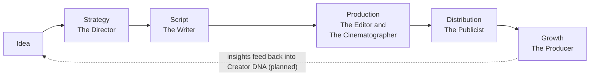
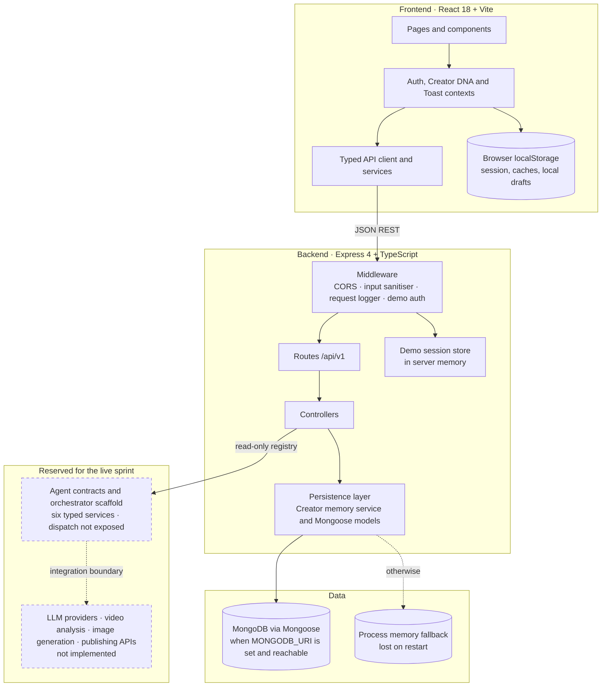

<div align="center">

# KREW


### Your Vision. Our Crew.

*Every Star Deserves a Crew.*

**An AI-powered creator workspace built around six specialised agents: a behind-the-scenes production crew that takes a creator from idea to growth.**

GeNarrative Clash 2026 · Track: Autonomous Creator Agents — Content Strategy & Distribution

</div>


<br />

> **Status in one sentence:** this repository is KREW's pre-event foundation: the product interface, API, data contracts and agent scaffolding. The AI capabilities (LLM inference, autonomous agent execution, video analysis, generation and publishing) are deliberately **reserved for the live six-hour hackathon sprint** and are not implemented here. See [The 50/50 Build Philosophy](#the-5050-build-philosophy).

## Contents

- [Overview](#overview)
- [The KREW: Six Specialised Agents](#the-krew-six-specialised-agents)
- [How KREW Works](#how-krew-works)
- [Product Modules and Maturity](#product-modules-and-maturity)
- [System Architecture](#system-architecture)
- [Technology Stack](#technology-stack)
- [Project Structure](#project-structure)
- [Getting Started](#getting-started)
- [API Reference](#api-reference)
- [Data and Persistence](#data-and-persistence)
- [The 50/50 Build Philosophy](#the-5050-build-philosophy)
- [Engineering Decisions and Transparency](#engineering-decisions-and-transparency)
- [Roadmap](#roadmap)
- [Security and Configuration Notes](#security-and-configuration-notes)
- [Development Guidelines](#development-guidelines)
- [Project Information](#project-information)

---

## Overview

Producing content is not one job. A creator plans a campaign, develops the idea, writes the script, shoots and reviews footage, designs the thumbnail, adapts the post for each platform, and then studies what worked. Each step usually lives in a different tool, and the creator's voice gets diluted as work moves between them.

KREW treats the creator as the **star** and gives them a **crew**: six specialised agents, each owning one stage of the workflow, working from one shared **Creator DNA** profile (voice, audience, tone, visual identity). The creator stays the decision-maker; the crew prepares the work.

KREW is not designed as a single chatbot. It is a coordinated, role-based workspace, and this repository contains the workspace, the data model and the contracts the crew will plug into.

**Current state, plainly:** you can sign into a local demo session, define a Creator DNA, create and manage production projects, and use the studio interfaces. The agents are present as typed contracts and interface identities; they do not yet execute work.

---

## The KREW: Six Specialised Agents

<table>
  <tr>
    <td align="center" width="33%">
      <br />
      <b>01 · THE DIRECTOR</b><br />
      <i>Strategy Agent</i><br />
      Content direction, campaign strategy, creator goals and planning.
    </td>
    <td align="center" width="33%">
      <br />
      <b>02 · THE WRITER</b><br />
      <i>Script Agent</i><br />
      Script development, storytelling, hooks and content structure.
    </td>
    <td align="center" width="33%">
      <br />
      <b>03 · THE EDITOR</b><br />
      <i>Video Intelligence Agent</i><br />
      Video understanding, timestamp analysis, highlights and clip intelligence.
    </td>
  </tr>
  <tr>
    <td align="center" width="33%">
      <br />
      <b>04 · THE CINEMATOGRAPHER</b><br />
      <i>Visual Intelligence Agent</i><br />
      Visual direction, thumbnail concepts, composition and visual identity.
    </td>
    <td align="center" width="33%">
      <br />
      <b>05 · THE PUBLICIST</b><br />
      <i>Distribution Agent</i><br />
      Distribution planning, platform strategy and publishing preparation.
    </td>
    <td align="center" width="33%">
      <br />
      <b>06 · THE PRODUCER</b><br />
      <i>Growth Intelligence Agent</i><br />
      Growth insights, performance interpretation and optimisation.
    </td>
  </tr>
</table>

**Implementation status.** Each agent exists today as a typed service contract (`backend/src/services/`) with a role, identity and declared hand-off targets, plus a portrait and profile in the interface. Calling an agent's `executeAgentTask` returns a `pending_live_sprint` result; no agent performs real work yet, and no API endpoint dispatches one.

---

## How KREW Works

The intended creator journey runs through six stages, one per agent:



| Layer | What exists today | What is planned |
|---|---|---|
| **Workflow foundation** | Project records with a status lifecycle and a pipeline step (0–5); brief, outline and script-note fields the creator fills in; Creator DNA profile; typed agent contracts with hand-off declarations | Agents that read Creator DNA and project data, produce outputs and hand work to each other |
| **Autonomous execution** | Not implemented | Reserved for the live sprint |

Nothing in the current workflow performs AI operations. Creating a project saves a `draft` record and starts no processing.

---

## Product Modules and Maturity

Every route exists in the app, but they are not equally mature. Maturity labels used below:

- **Backend-connected:** reads and writes through the API.
- **Browser-local:** saved in this browser's `localStorage` only.
- **Illustrative:** sample content, explicitly labelled in the UI as not live data.

| Module | Route | What works today | Maturity |
|---|---|---|---|
| **Landing page** | `/` | Public product page presenting the crew and the workflow; states that autonomous execution is reserved. | Static presentation |
| **Authentication** | `/login`, `/signup`, `/forgot-password` | Local **demo-mode** sign-in and sign-up against the API; session restored on reload. The forgot-password screen is interface only (there is no reset endpoint). | Backend-connected (demo mode) |
| **Command Center** | `/dashboard` | Project counts and recent projects come from the API. The Creator DNA summary and content calendar are local or illustrative. | Partly backend-connected |
| **Creator DNA** | `/creator-dna` | Edit identity, audience, tone, vocabulary, storytelling and visual identity; server-side validation, version counter, sync-request timestamp, local offline cache. | Backend-connected |
| **Meet the KREW** | `/crew` | The six agent cards, detail views and a collaboration diagram labelled as illustrative. | Static / illustrative |
| **Production Studio** | `/production` | Create, list, filter, search and sort projects; edit brief and creative notes (idea, outline, script draft, talking points); change status; archive. Source-file *metadata* is recorded; the file itself is not stored. | Backend-connected |
| **Clip Intelligence** | `/clip-intelligence` | Preview a local video in the browser and add timestamped moments by hand, with notes and review status. The video is not uploaded or analysed. | Browser-local |
| **Thumbnail Studio** | `/thumbnail-studio` | Manual layered editor: multiple versions, text layers, brand colours, 16:9 / 9:16 / 1:1 aspect ratios. Saved to the project via the API (with a local draft cache). No image generation. | Backend-connected (manual editor) |
| **Distribution Desk** | `/distribution` | Per-platform post drafts (YouTube, Instagram, LinkedIn, Facebook) seeded from sample content, editable, with a review checklist. Drafts stay in the browser; nothing is published. | Browser-local, sample-seeded |
| **Growth Insights** | `/growth-insights` | Recharts visualisations built entirely from sample data, labelled as such. | Illustrative |
| **Settings** | `/settings` | Studio preferences stored in the browser; session information and sign-out. Provider connections are shown as inactive; no API keys are collected. | Browser-local |

---

## System Architecture



**Frontend.** A routed single-page app with public and protected layouts. A typed API client (`services/api.ts`) wraps `fetch` with timeouts and a uniform error type; one service per resource sits on top of it. Authentication and Creator DNA state live in React contexts.

**Backend.** A conventional route → controller → persistence layering. Middleware handles CORS, request-body sanitisation (keys beginning with `$` or containing `.` are stripped), request logging and bearer-token checks against the in-memory demo session store.

**Integration boundary.** The six agent contracts (`IAgentContract`, `AgentRole`, `ISpecialisedAgentContract`) and an `AgentOrchestrator` registry define where the live sprint plugs in. The orchestrator has a `dispatch` method, but no route calls it, and every agent currently returns `pending_live_sprint`.

---

## Technology Stack

| Area | Technologies |
|---|---|
| **Frontend** | React 18, React Router 6, Vite 5, Tailwind CSS 3 |
| **Backend** | Node.js, Express 4, `cors`, `dotenv` |
| **Database** | MongoDB through Mongoose 8 (optional; in-memory fallback otherwise) |
| **Language and tooling** | TypeScript 5 (frontend and backend), `tsx` for backend development, `tsc` for backend builds, npm scripts at the repo root |
| **Visualisation and UI** | Recharts, Lucide React, `clsx`, `tailwind-merge` |

No LLM SDKs, video-processing libraries, image-generation services or social-platform SDKs are installed.

---

## Project Structure

```text
KREW/
├── frontend/
│   ├── public/
│   │   ├── favicon.svg
│   │   └── images/agents/          # the six agent portraits (.jpg)
│   └── src/
│       ├── pages/                  # landing, auth/, app/ (studio screens)
│       ├── components/             # agents, dashboard, production, thumbnails,
│       │                           # navigation, common, ui
│       ├── contexts/               # Auth, Creator DNA, Toast state
│       ├── layouts/                # public and app shells
│       ├── services/               # typed API client + per-resource services
│       ├── types/                  # shared TypeScript contracts
│       ├── data/                   # agent registry and labelled sample fixtures
│       ├── hooks/  utils/  styles/
│       ├── App.tsx                 # route map
│       └── main.tsx
├── backend/
│   └── src/
│       ├── server.ts  app.ts       # startup, Express configuration
│       ├── config/                 # environment and database setup
│       ├── routes/  controllers/   # /api/v1 endpoints and handlers
│       ├── middleware/             # auth, request logging, error handling
│       ├── models/  interfaces/    # Mongoose schemas and TypeScript contracts
│       ├── utils/                  # response envelope, logger
│       └── services/
│           ├── creatorMemory/      # Creator DNA persistence
│           ├── demoSessionStore.ts # in-memory demo sessions
│           ├── agentOrchestration/ # agent registry and dispatch scaffold
│           └── strategyAgent/  scriptAgent/  videoIntelligence/
│               visualIntelligence/  distribution/  growthIntelligence/
├── docs/                           # architecture, roadmap, agent spec, product vision
├── .env.example
├── AGENTS.md
└── package.json                    # root scripts delegating to both packages
```

---

## Getting Started

**Requirements:** Node.js 18+ and npm 9+. MongoDB is optional.

**1. Install dependencies**

```sh
npm run install:all
```

**2. Configure the backend environment**

```sh
cp .env.example backend/.env
```

The backend works with the defaults. Set `MONGODB_URI` in `backend/.env` only if you have a MongoDB instance (local or Atlas); leave it empty to run in the in-memory mode described under [Data and Persistence](#data-and-persistence). The other `*_API_KEY`, `CLOUDINARY_URL` and `AWS_S3_BUCKET` entries in `.env.example` are placeholders reserved for the live sprint and are not used by any code today. Never commit real credentials; `.env` is git-ignored.

**3. Frontend API URL (optional)**

The frontend defaults to `http://localhost:5001/api/v1`. To point it elsewhere, create `frontend/.env`:

```sh
VITE_API_URL=http://localhost:5001/api/v1
```

**4. Start both servers** (two terminals)

```sh
npm run dev:backend
```

```sh
npm run dev:frontend
```

| Service | URL |
|---|---|
| Application | http://localhost:5173 |
| API health check | http://localhost:5001/api/v1/health |

The API uses port `5001` by default and moves to the next free port if it is occupied; if that happens, set `VITE_API_URL` to match. The API allows CORS from `http://localhost:5173` (plus anything listed in `CORS_ORIGIN`).

**5. Build for production**

```sh
npm run build            # frontend, then backend
npm start --prefix backend         # run the compiled API (dist/server.js)
npm run preview --prefix frontend  # preview the built frontend
```

`npm run build:frontend` and `npm run build:backend` build each package separately. The repository does not currently include an automated test suite.

---

## API Reference

All routes are served under `/api/v1`. Every response uses one JSON envelope:

```json
{ "success": true, "message": "…", "data": { }, "timestamp": "2026-01-01T00:00:00.000Z" }
```

Errors return `{ "success": false, "message": "…", "timestamp": "…" }` with the matching HTTP status.

**Authentication.** Routes marked 🔒 require `Authorization: Bearer <token>`, where the token comes from `/auth/login` or `/auth/register`. Tokens are demo-session tokens (see [Security and Configuration Notes](#security-and-configuration-notes)).

| Method | Endpoint | Auth | Purpose |
|---|---|---|---|
| GET | `/health` | | Service status and persistence mode |
| POST | `/auth/register` | | Start a local demo session (`name`, `email`, `password`) |
| POST | `/auth/login` | | Start a local demo session (`email`, `password`) |
| GET | `/auth/me` | 🔒 | Validate the current session |
| POST | `/auth/logout` | 🔒 | Revoke the current session |
| GET | `/creator-dna` | 🔒 | Read the Creator DNA profile (a default is created on first read) |
| PUT | `/creator-dna` | 🔒 | Save a validated profile; increments the version |
| POST | `/creator-dna/sync` | 🔒 | Record a sync request (timestamp and status only; no agents run) |
| GET | `/creator-dna/metadata` | 🔒 | Read version, sync status and persistence mode |
| GET | `/projects` | 🔒 | List your projects; query `status`, `search`, `sort=asc\|desc` |
| POST | `/projects` | 🔒 | Create a project; always starts as `draft` |
| GET | `/projects/:id` | 🔒 | Project detail |
| PUT | `/projects/:id` | 🔒 | Update metadata (title, description, source info, brief, creative workspace, thumbnail workspace, `pipelineStep`) |
| PATCH | `/projects/:id/status` | 🔒 | Update status: `draft`, `queued`, `in_production`, `review_ready`, `approved`, `archived` |
| DELETE | `/projects/:id` | 🔒 | Archive the project (soft delete; sets status to `archived`) |
| GET | `/agents` | | Read the agent registry (role, identity, scaffold status) |
| GET | `/agents/:role/contract` | | Read one agent's contract description; no execution |

`/health` is also reachable at `/health` and `/api/health` for probes. Project and Creator DNA data is scoped to the signed-in demo identity.

---

## Data and Persistence

| Data | MongoDB connected | MongoDB not configured or unreachable |
|---|---|---|
| **Creator DNA profile** | Stored in MongoDB (`CreatorProfile` model) | Held in server process memory |
| **Projects** | Stored in MongoDB (`ContentProject` model) | Held in server process memory |
| **Demo sessions** | Always in server memory | Always in server memory |

- **Mode detection.** On startup the server tries to connect when `MONGODB_URI` is set; on a missing, placeholder or unreachable URI it logs a warning and continues in-memory.
- **Transparent reporting.** `GET /health` and persistence-aware responses include `mode` (`mongodb` or `in-memory`) and `persistenceAcrossRestarts`. In in-memory mode, data is lost whenever the backend restarts, and success messages say so.
- **Browser-local data.** The client uses `localStorage` for the demo session, a Creator DNA offline cache, studio preferences, drafts of production notes and thumbnail workspaces, manually entered clip moments, and distribution drafts and checklist. This is convenience and offline state, not a substitute for backend persistence.
- **Files.** Video and image files chosen in the interface stay in the browser session. Only file *metadata* (name, type, size) is sent to the API. KREW does not currently store or serve uploaded files.
- **Unused schemas.** `User`, `ContentAsset`, `DistributionPlan` and `AgentDefinition` Mongoose models are defined but are not yet used by any endpoint.

---

## The 50/50 Build Philosophy

KREW follows a deliberate **50/50 boundary** between pre-event engineering and live-sprint implementation.

**Established before the hackathon:** the interface and design system, application and API architecture, validated data contracts, project and Creator DNA management, honest persistence behaviour, and typed integration points for the six agents.

**Reserved for the live sprint:** everything that makes the crew *intelligent*: model integration, prompting, agent execution and communication, and the AI-driven studio features.

**Why separate them.** The foundation is deterministic engineering that can be built, reviewed and verified in advance. The intelligent layer is the substance of the event track, and building it during the sprint keeps the core autonomous-agent work visible and accountable. Because the foundation is finished first, sprint time goes into the agents rather than into scaffolding.

**How the current architecture supports it.** Each agent already has a typed contract (`executeAgentTask`, `validateInputContract`, `AgentContext` carrying the creator's Creator DNA, a standard `AgentExecutionResult` with hand-off targets). The orchestrator registry and `dispatch` method give a single place to wire execution, and the project model already carries `activeAgents`, `pipelineStep` and workspace fields for agent output to land in.

| Capability | Current status | Planned live-sprint work |
|---|---|---|
| LLM provider integration and inference | No LLM SDKs installed; provider keys in `.env.example` are unused placeholders | Integrate provider(s) and run inference |
| Prompt engineering | Not started | Design and tune per-agent prompts |
| Agent orchestration | Typed contracts and registry; `dispatch` exists but no endpoint calls it; agents return `pending_live_sprint` | Real execution through the orchestrator |
| Agent-to-agent communication | Hand-off targets declared as data in contracts | Working hand-offs between agents |
| Strategy and script generation | Brief and script fields are written by the creator | Director and Writer generate content |
| Video analysis and scoring | Local video preview with manually entered timestamps | Timestamp detection and highlight scoring |
| AI thumbnail generation | Manual layered thumbnail editor | Generated concepts and visual optimisation |
| Direct social publishing | Local drafts only; no platform APIs or OAuth | Publishing and scheduling integrations |
| Growth optimisation loops | Growth page uses sample data | Real metrics ingestion and recommendations |
| Creator DNA sync to agents | Sync records a request timestamp only | Propagate Creator DNA to agent context |
| Production authentication | Local demo mode | Real identity and session management |

---

## Engineering Decisions and Transparency

- **Typed contracts first.** Agent roles, execution results and project shapes are TypeScript types shared in spirit across both packages, so the live sprint fills in implementations behind stable interfaces.
- **Project operations are separate from AI execution.** Creating or editing a project never triggers agent work: new projects are `draft` with no active agents, and the interface says so. Agent execution will be an explicit, separate step.
- **Demo authentication is labelled as such.** Sign-in screens carry a "Local DEMO MODE · Not production-secure" marker, and API responses state the same, rather than presenting placeholder auth as real.
- **In-memory fallback exists so the app runs anywhere.** It lets anyone clone and run KREW without a database, and the API reports the mode so it is never mistaken for durable storage.
- **Sample data is identified.** Illustrative content (growth charts, calendar, distribution seeds, collaboration diagram) is tagged in the interface as sample or illustrative.
- **Per-creator scoping.** Projects and Creator DNA are keyed to the signed-in identity.
- **Defensive request handling.** Bodies are sanitised against `$`-operator and dotted keys, inputs are validated per route, and request logs record method, path, status and duration only, not bodies or credentials.

---

## Roadmap

| Phase | Item | State |
|---|---|---|
| **Foundation (in this repository)** | React application, design system, routed studio | Present |
| | Express API, response envelope, health, error handling | Present |
| | Creator DNA and project management with MongoDB or in-memory persistence | Present |
| | Demo-mode authentication | Present (not production-grade) |
| | Typed agent contracts, registry and orchestrator scaffold | Present (no execution) |
| **Housekeeping before the sprint** | Configure the lint toolchain (the `lint` script is declared; ESLint is not installed) | Open |
| | Automated API tests for MongoDB and in-memory modes | Open |
| **Live sprint** | LLM integration, prompts, agent execution and hand-offs | Reserved |
| | Video analysis, thumbnail generation, publishing, growth loops | Reserved |
| | Production authentication | Reserved |

---

## Security and Configuration Notes

- **Environment variables.** Configuration is read from `backend/.env`, which is excluded from Git. `.env.example` contains no secrets. Active variables are `PORT`, `NODE_ENV`, `API_PREFIX`, `CORS_ORIGIN` and `MONGODB_URI`.
- **Demo authentication is not production authentication.** Any well-formed email and a password of 8–128 characters starts a session. Passwords are validated for length only and are never stored or logged. Identity is derived from the email address with no ownership verification, so anyone using the same email reaches the same demo workspace. Do not store sensitive data in a demo deployment.
- **Sessions.** Tokens are random, held only in server memory, expire after eight hours and disappear on restart. The client keeps its copy in `localStorage`. (`JWT_EXPIRES_IN` appears in `.env.example` but no JWTs are issued.)
- **Persistence fallback.** Without MongoDB, data is temporary; check `GET /health` for the current mode.
- **Provider credentials.** The Settings interface does not collect or store API keys, and no provider is connected.
- **Public routes.** `/health`, `/agents`, `/agents/:role/contract` and the auth entry points do not require a token.
- **Not claimed.** This foundation makes no production-readiness, rate-limiting or hardening guarantees.

---

## Development Guidelines

- Run commands from the repository root; root scripts delegate to `frontend/` and `backend/`.
- Keep changes within each package's TypeScript types and conventions; see [`AGENTS.md`](AGENTS.md) for a short repository guide and [`docs/`](docs) for architecture, roadmap, the agent specification and product vision.
- Keep the 50/50 boundary clear: label sample data as sample, and mark anything not yet implemented as reserved rather than live.

---

## Project Information

- **Project:** KREW: *Your Vision. Our Crew.*
- **Event:** GeNarrative Clash 2026
- **Track:** Autonomous Creator Agents — Content Strategy & Distribution
- **Team FourBits :** Aryan Raj Tiwary, Sruti Pandey, Shreejata Mukhopadhyay , Hrisit Das
- **License:** the package metadata declares `MIT`, but the repository does not include a `LICENSE` file; add one to make the terms explicit.
